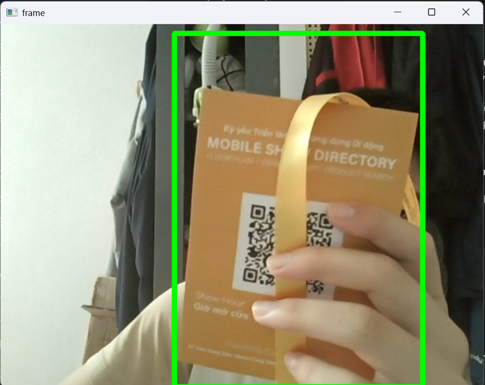
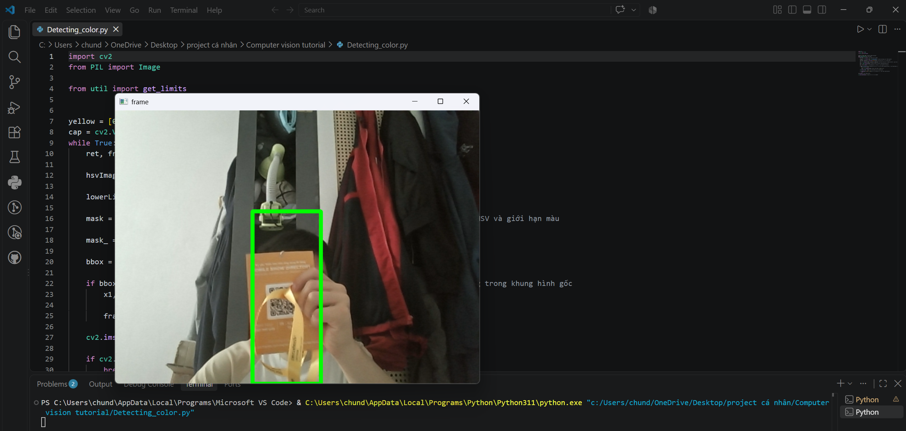

# Nhận diện vùng màu qua webcam — Webcam Color Detection

[Tiếng Việt](README.md) | [English](README.en.md)

Dự án thực hành **Computer Vision** (thị giác máy tính) dùng Python và OpenCV để nhận diện các vùng màu vàng trong khung hình webcam. Chương trình chọn pixel theo ngưỡng màu **HSV**, rồi vẽ một **bounding box** (khung bao) quanh toàn bộ vùng được chọn.

## Ảnh demo




Khung màu xanh bao các pixel thỏa ngưỡng HSV của màu vàng. Vùng nền có màu tương tự cũng có thể bị chọn; đây là nhận diện theo màu, chưa phải phân loại đối tượng.

## Cách hoạt động

1. OpenCV đọc từng khung hình (*frame*) từ webcam.
2. Chuyển ảnh từ **BGR** sang **HSV**.
3. `get_limits()` tính ngưỡng HSV từ màu mục tiêu; `cv2.inRange()` tạo **binary mask** (mặt nạ nhị phân).
4. Pillow tìm bounding box của toàn bộ pixel khác 0 trong mask.
5. OpenCV vẽ khung bao lên ảnh và hiển thị kết quả.

Nếu có nhiều vùng màu tách rời, chương trình vẽ **một khung chung**, không tạo khung riêng cho từng vùng.

## Công nghệ

| Thành phần | Vai trò |
| --- | --- |
| Python | Ngôn ngữ lập trình |
| OpenCV | Đọc webcam, chuyển không gian màu và hiển thị |
| NumPy | Biểu diễn ảnh và ngưỡng bằng mảng |
| Pillow | Tìm khung bao từ mask bằng `Image.getbbox()` |

## Cài đặt và chạy

Cần Python, webcam và môi trường desktop có thể mở cửa sổ OpenCV. Repo chưa ghi phiên bản Python đã kiểm thử; `requirements.txt` hiện không khóa phiên bản thư viện.

Ví dụ trên Windows PowerShell, từ thư mục chứa `Detecting_color.py`:

```powershell
git clone https://github.com/DuongDuyet2909/opencv-color-detection.git
cd opencv-color-detection
python -m venv .venv
.\.venv\Scripts\python.exe -m pip install -r requirements.txt
.\.venv\Scripts\python.exe Detecting_color.py
```

Trên macOS/Linux, tạo môi trường bằng `python3 -m venv .venv` rồi dùng `.venv/bin/python` thay cho `.\.venv\Scripts\python.exe`. Khả năng chạy trên từng nền tảng chưa được xác minh trong lượt Việt hóa này.

Ứng dụng dùng camera có chỉ số **`0`**. Chọn cửa sổ webcam rồi nhấn **`q`** để thoát.

## Tùy chỉnh màu

Màu mục tiêu nằm trong biến `yellow` ở `Detecting_color.py`. Giá trị `[0, 255, 255]` dùng thứ tự **BGR**, tương ứng màu vàng. Tên biến và API được giữ nguyên để dễ đối chiếu mã nguồn.

`get_limits()` trong `util.py` chuyển màu mục tiêu sang HSV, dùng khoảng hue gần màu đó và ngưỡng tối thiểu cho saturation/value. Cách xử lý hue ở gần đầu/cuối dải màu đỏ hiện chỉ trả về một khoảng; chưa ghép đầy đủ hai khoảng màu đỏ quanh điểm nối vòng.

## Thuật ngữ

| Thuật ngữ | Ý nghĩa |
| --- | --- |
| BGR — Blue, Green, Red | Thứ tự kênh màu mặc định của ảnh OpenCV |
| HSV — Hue, Saturation, Value | Không gian màu gồm sắc độ, độ bão hòa và độ sáng |
| Threshold | Ngưỡng dùng để chọn pixel |
| Binary mask | Mặt nạ nhị phân; pixel được chọn mang giá trị 255, nền là 0 |
| Bounding box | Hình chữ nhật bao quanh vùng được chọn |
| Contour | Đường biên của một vùng ảnh; có thể dùng để tách các vùng riêng biệt |

## Giới hạn

- Ánh sáng ảnh hưởng màu ghi nhận và kết quả chọn pixel.
- Nền có màu nằm trong cùng ngưỡng có thể được chọn.
- Các vùng tách rời được gộp trong một bounding box.
- Chương trình nhận diện **vùng màu**, không xác định loại đồ vật.
- Mã hiện chưa kiểm tra lỗi mở camera hoặc lỗi đọc frame trước khi xử lý.

## Hướng phát triển

- Thêm thông báo lỗi camera và kiểm tra frame hợp lệ.
- Lọc các vùng nhiễu nhỏ.
- Dùng contour để tạo khung riêng cho từng vùng.
- Cho phép cấu hình màu và chọn camera bằng tham số.
